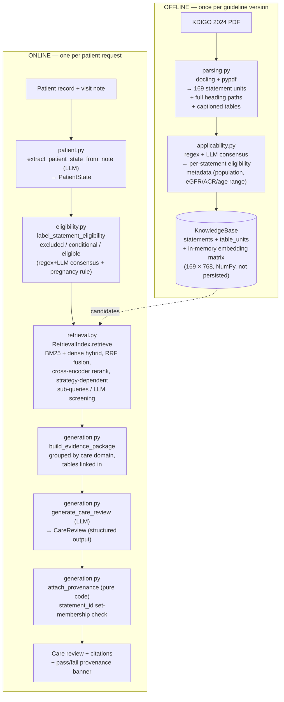

# CKD Guideline Retrieval + Care Review — System Walkthrough

- Research prototype, **synthetic patients only** — not a clinical decision-support system
- Input: patient record + free-text visit note
- Output: KDIGO 2024 CKD guideline statements the clinician should see + a drafted care review, citations checked in code, not trusted to the model

---

## Index — what to talk about

| # | Section | Talking point |
|---|---|---|
| 1 | [Architecture](#1-architecture) | Offline vs. online split, end-to-end diagram |
| 2 | [Sample patient walkthrough — P001](#2-sample-patient-walkthrough--p001) | Live example: record → `PatientState` → `derive` → sub-queries |
| 3 | [Embeddings](#3-embeddings) | Model, asymmetric query prefix, no vector store, reranker comparison |
| 4 | [Where LLMs are used](#4-where-llms-are-used) | 4 call sites, all `gpt-4.1`, single structured-output calls |
| 5 | [Grading](#5-grading-grade-strengthcertainty) | GRADE strength/certainty mapping, how wording matches grade |
| 6 | [Table maps](#6-table-maps--what-they-do-where-inserted) | How linked tables get inlined into the prompt |
| 7 | [Retrieval strategy comparison](#7-retrieval-strategy-comparison) | Recall/inappropriate table, why the default strategy was picked |
| 8 | [Why a fixed pipeline, not an agent](#8-why-a-fixed-pipeline-not-an-agent) | Reproducibility argument, where an agent would actually help |
| 9 | [Problems hit, and how resolved](#9-problems-hit-and-how-resolved) | Concrete technical challenges + fixes |
| 10 | [Current weak points / open gaps](#10-current-weak-points--open-gaps) | Honest limitations |
| 11 | [Future work / what production would need](#11-future-work--what-production-would-need) | Deployment roadmap, recall target for production |

---

## 1. Architecture

Two pipelines, run at very different times:



- Offline half: runs once, cached to disk (`notebooks/data/cache/`)
- Online half: fresh, uncached, every request (why: §4)

---

## 2. Sample patient walkthrough — P001

Real output from current code, offline steps only (no LLM calls — free to reproduce).

**Input** — `sample_patients.RECORDS["P001"]` + the note:

```json
{
  "demographics": {"age": 67, "sex": "M"},
  "diagnoses": ["Hypertension"],
  "medications": ["Amlodipine 10 mg daily"],
  "labs": [
    {"date": "2026-04-12", "test": "eGFR", "value": 48, "unit": "mL/min/1.73m2"},
    {"date": "2026-04-12", "test": "Creatinine", "value": 1.6, "unit": "mg/dL"}
  ]
}
```

```text
Note: "67M, HTN on amlodipine 10. Increasing fatigue over recent months. BP 158/94 today,
       still elevated despite meds. Recent bloods: eGFR 48, creat 1.6. No urine ACR on file.
       What should we do?"
```

**`PatientState`** (`extract_patient_state_from_note` + record mapper):

```json
{
  "age": 67, "sex": "M", "egfr": 48.0, "egfr_date": "2026-04-12", "sbp": 158,
  "known_ckd": false, "hypertension": true, "on_dialysis": false, "kidney_transplant": false,
  "medications": ["Amlodipine 10 mg daily"], "symptoms": ["fatigue"],
  "concerns": ["blood pressure uncontrolled"]
}
```
- One structured object, reasoned over by everything downstream — note itself is never re-read after this

**`derive(state)`** — pure code, no LLM, runs right after `PatientState`, before filtering:

```json
{
  "is_adult": true,
  "gfr_category": "G3a",
  "acr_category": null,
  "risk_category": null,
  "drug_classes": ["CCB"],
  "missing_data": ["urine ACR", "diabetes status"]
}
```
- Turns raw fields → categorical values the eligibility rules match against (GFR/ACR category, risk-heatmap cell, drug classes, what's missing)
- `acr_category`/`risk_category` null here → no ACR on file → `missing_data` catches it → statements needing it become `conditional`, not silently eligible/dropped
- Feeds `check_applicability()`: `is_adult` → pediatric/adult checks; `drug_classes` → pregnancy rule (`PREGNANCY_AVOID`)
- Never touches the guideline statements itself — only transforms the patient

**Template sub-queries** (`build_template_subqueries`, pure code, no LLM, always runs):

```text
confirm chronicity of CKD after a single low eGFR; repeat testing; evaluate cause of CKD in adults
test urine albumin-to-creatinine ratio ACR and eGFR to detect and stage CKD G3a in adults
frequency of monitoring eGFR and albuminuria in people with CKD G3a
kidney failure risk prediction equation and criteria for referral to nephrology in CKD G3a
statin treatment to reduce cardiovascular risk in adults aged 67 with eGFR 48
SGLT2 inhibitor treatment for adults with CKD eGFR 48
renin-angiotensin system inhibitor ACEi or ARB for CKD with albuminuria
medication management, drug dosing and nephrotoxic drug avoidance with reduced eGFR 48
blood pressure target and antihypertensive treatment for adults with CKD and high blood pressure
assessment and management of fatigue and uremic symptoms in CKD
```
- Already covers routine care the note never asked about (statin, SGLT2i, referral) — guards against LLM-only retrieval skipping mandated routine care (gap #12/#18, §9)

**Rest of the flow** (pipeline default = `llm_based_retrieval_plus_query_reformulation`):
1. `llm_based_retrieval` runs first — LLM gets full `PatientState` + `derive()` output + the raw clinician note verbatim + every remaining eligible candidate statement's full text, all as plain prompt text; it reads and picks directly, no embedding/vector step at all → ordered, precise picks
2. Separately: template queries + LLM gap-fill queries → concatenated into one query list, but **each query embedded + hybrid-retrieved + reranked individually** (one `hybrid()`/`rerank()` call per query, not one combined embedding) → per-query ranked lists merged by `interleave()` (round-robin) into a single ranked list
3. Final list = step 1's picks, then step 2's ranked results fill remaining slots up to k (skipping anything already picked)
→ evidence package → one LLM call drafts `CareReview` → code checks every cited `statement_id` against the package

---

## 3. Embeddings

**What / how:**
- Statement text embedded once offline → 768-dim vector (`BAAI/bge-base-en-v1.5`, local, `sentence-transformers`, L2-normalized → cosine ≡ dot product)
- Query embedded with same model, BGE asymmetric prefix prepended:

```text
document text  →  bge-base-en-v1.5  →  768-dim vector         (no prefix)
query text     →  "Represent this sentence for searching relevant passages: " + text
               →  bge-base-en-v1.5  →  768-dim vector
```
- Prefix matters — BGE fine-tuned on this exact asymmetric convention, dropping it measurably hurts retrieval
- Rationale text deliberately **not** embedded — too general, would blur what the statement is about

**No vector store:**
- `KnowledgeBase.doc_vectors` = plain in-memory NumPy array, 169×768, rebuilt on process start, never persisted
- Retrieval = brute-force dot product, no FAISS/Pinecone/Weaviate, no similarity threshold — pure rank-based top-k
- Fine at 169 statements; would **not** hold at thousands of statements / multiple guidelines (→ §11)

**Reranking:**
- Hybrid (BM25 + dense, RRF fusion k=60) → cross-encoder rerank
- Compared: `bge-reranker-v2-m3` (general) vs `ncbi/MedCPT-Cross-Encoder` (medical-domain) → **near-identical**, no domain advantage found → kept BGE (no reason to add a second model)

**Not actually compared:**
- `config.py` has a switchable `EMBEDDING_BACKEND` (local BGE vs OpenAI `text-embedding-3-small`) — OpenAI path exists in code but was **never benchmarked**; every recall number here is BGE-only

---

## 4. Where LLMs are used

All `gpt-4.1`, each a single structured-output call, never multi-turn/agentic (§8):

| Step | Function | What it does | Always runs? |
|---|---|---|---|
| Note extraction | `extract_patient_state_from_note` | Note → structured `PatientState` | Yes |
| Sub-query gap-fill | `build_llm_gap_subqueries` | Sees checklist, returns only gaps | Strategy-dependent |
| Retrieval screening | `RetrievalIndex.llm_based_retrieval` | Picks which candidates actually apply | Strategy-dependent |
| Generation | `generate_care_review` | Evidence package → `CareReview` | Yes |

- `temperature=0` pinned on retrieval/sub-query calls (determinism > variety there); not pinned on note extraction/generation
- All four traced automatically via `langfuse.openai`'s client wrapper — no extra code per call

---

## 5. Grading (GRADE strength/certainty)

Statement ends in a grade code e.g. `(1A)`, `(2C)` — regex-parsed.

| Grade part | Meaning | Mapping |
|---|---|---|
| Digit (`1`/`2`) | Strength | `1` → "strong recommendation" · `2` → "weak recommendation (suggestion)" |
| Letter (`A`–`D`) | Certainty of evidence | `A` high · `B` moderate · `C` low · `D` very low |
| No grade | Practice Point | "expert practice point (ungraded)" |

- Generation prompt matches wording to grade (recommends / suggests / expert practice point) — avoids overstating weak/ungraded statements

---

## 6. Table maps — what they do, where inserted

- Statements often reference "see Table 5" etc.
- Pass 1: regex on statement text → `statement["table_refs"]`, e.g. `["Table 5"]`
- Pass 2 (separate): docling-detected tables/figures → `{table_id, caption, markdown, page}`, markdown not image — plain text
- Build-time: `table_refs` resolved against that dict → attached as `linked_tables`
- Inlined under the statement, capped at 1000 chars/table:

```text
Rec 1.2.1 (grade 1A, p.12)
<statement text>
  [Table 2] GFR categories in CKD
  | Category | GFR (mL/min/1.73m²) | Terms |
  |---|---|---|
  | G1 | ≥90 | Normal or high | ...
```
- LLM sees real table content inline, no vision/OCR step needed — docling already extracted structure as text

---

## 7. Retrieval strategy comparison

12-patient draft gold set, Claude-labeled not clinician-reviewed — POC signal, not a validated benchmark.

| Strategy | recall@15 | | recall@25 | recall@35 | inappropriate@15 | |
|---|---|---|---|---|---|---|
| `dense_raw` *(internal, no reformulation)* | 0.34 | `███░░░░░░░` | 0.40 | 0.47 | 3.58 | `███████░` |
| `hybrid_raw` *(internal, no reformulation)* | 0.32 | `███░░░░░░░` | 0.40 | 0.49 | 3.75 | `████████` |
| `filtered_hybrid_raw` *(no reformulation)* | 0.36 | `████░░░░░░` | 0.46 | 0.52 | 0.58 | `█░░░░░░░` |
| `code_query_reformulation_rerank` | 0.39 | `████░░░░░░` | 0.45 | 0.52 | 0.17 | `░░░░░░░░` |
| `llm_query_reformulation_rerank`¹ | 0.42 | `████░░░░░░` | 0.58 | 0.66 | 0.50 | `█░░░░░░░` |
| `code_and_llm_query_reformulation_rerank`¹ | 0.47 | `█████░░░░░` | 0.58 | 0.68 | 0.17 | `░░░░░░░░` |
| `llm_based_retrieval` | 0.67 | `███████░░░` | 0.80 | 0.80 | 0.00 | `░░░░░░░░` |
| **`llm_based_retrieval_plus_query_reformulation`¹** (default) | 0.67 | `███████░░░` | **0.82** | **0.93** | 0.00 | `░░░░░░░░` |

¹ Real, measured numbers (2026-09-25/27) — but measured *before* the sub-query redesign (§9), which changed how these three strategies build their queries. Last known good; confirming they still hold against today's code is open work.

**End-to-end confirmation that k=35 > k=25** (2026-09-27 run, 12 patients + fresh P013, same pre-redesign caveat):

| Metric | k=25 | k=35 |
|---|---|---|
| `must_cited` (gold `must` statements actually cited in the final report — stricter than reaching top-k) | 0.64 | **0.73** |
| Invalid citations | 0/12 | 0/12 |
| Unsupported recommendations | 0/12 | 0/12 |
| Inappropriate citations | 1 (`Rec 3.7.3`, P012, hemodialysis — out of scope population) | 0 |

P013 (new patient, nothing precomputed) ran end to end with no errors at either k.

**Takeaways:**
- Raw dense/hybrid, no eligibility filter → low recall *and* unsafe (3.5+ inappropriate/patient, mostly wrong-population statements) — filter alone fixes most of it
- Only `llm_based_retrieval` variants clear recall@15 > 0.6 → why one is the default

---

## 8. Why a fixed pipeline, not an agent

- 3 LLM steps (sub-query/screening, generation, note extraction), all at fixed points, deterministic sequence
- Nothing needs an LLM to decide *which step runs next*
- Reproducibility argument: variable-length agentic loops are harder to evaluate against a fixed gold set, harder to debug, than one deterministic call — added cost/failure mode for no benefit here
- Where an agent *would* help: choosing **among already-validated retrieval strategies** per patient (e.g. fall back to the stronger strategy only if a cheaper one's confidence looks low) — bounded, evaluable choice, not open-ended tool use

---

## 9. Problems hit, and how resolved

(Genuine technical/data problems — not tooling/observability incidents.)

| Problem | Found by | Fix |
|---|---|---|
| PDF symbol font decoded wrong (`‡50`=`≥50`); docling dropped spaces | reading output | glyph map + respacing from pypdf |
| Statements truncated by page breaks / mislabelled by docling | pypdf completeness check | fall back to summary copy; match lines before trusting item-type |
| Raw-note dense retrieval surfaced pediatric/wrong-threshold statements | gold-set eval | eligibility filter added before retrieval |
| Regex read "A or B" as "A required" (hid statement from valid patients) | filter-error check | consensus filter + `alternative_only_criteria` field, enforced in code |
| LLM-only extraction invented constraints not in the text | filter-error check | LLM as second opinion, not sole source; consensus rule |
| One query can't cover every care domain | gold-set eval | code-authored sub-query checklist, run in parallel, interleaved |
| LLM screening missed routine care note didn't ask about | per-patient miss analysis | always-on code checklist as gap-fill (default strategy) |
| Pregnancy: RASi still shown to pregnant patient — not stated in KDIGO text itself | gold-set pregnancy case | patient-side rule, not metadata fix (`pregnant` → flag `drug_classes ∩ {RASi, SGLT2i, MRA, statin}`), zero extra LLM calls |
| Sub-query gen: independent LLM decomp + post-hoc string-dedup — brittle & wasteful | prompt design review | LLM sees checklist first, returns only gaps — no dedup needed |
| Results not reproducible run-to-run on identical input | comparing two runs | real OpenAI default `temperature` is 1.0, not 0 — pinned `temperature=0` where determinism matters |

---

## 10. Current weak points / open gaps

- `heading_path` stored per statement but **not inserted into generation prompt** — only used for citation display later
- Note-extraction accuracy not fully verified (e.g. one patient: "no diabetes" inferred, note never says either way) — no trap-set test yet
- Medication dedup is naive — `"Amlodipine 10 mg daily"` vs `"amlodipine 10"` can both land in the list
- Lab trends not computed — declining eGFR only visible if clinician mentions it in the note
- Only one safety rule exists (pregnancy) — dialysis-population rule still missing (one inappropriate statement leaks at k=25, resolves at k=35 but that's relying on a bigger k, not a real rule)
- Duplicate statement-ID citations not de-duplicated — cosmetic only, text always sourced from the guideline, never the model
- Gold set is 12 patients, Claude-labeled, not clinician-reviewed — good for failure *types*, not precise numbers (one statement moves recall 6–17 points)

---

## 11. Future work / what production would need

*(open, growing list)*

**Testing & evaluation**
- Deeper test coverage (parsing edge cases, eligibility edge rules, provenance under adversarial output)
- Larger **clinician-reviewed** gold set (30–50+ patients, every domain/rule ×2+)
- Recall measured **per safety-critical category**, not blended (see recall target below)
- **Online evals**: citation-validity rate over time, clinician override/edit rate, latency/cost per request, drift if LLM/embedding model upgraded
- Opt-in toggle to re-enable per-patient inference cache (currently always live, by design)

**Data & ingestion**
- Real ingestion pipeline for **multiple guideline documents** — today, one hardcoded KDIGO PDF
- More general transformation/chunking logic — current parsing tuned specifically to KDIGO's structure

**Scale**
- Real vector store (Pinecone/Weaviate/pgvector) once past a few hundred statements — current in-memory brute-force scan won't hold at thousands of statements / multiple guidelines, and isn't persisted

**Deployment**
- **Dockerization** — none yet, just `pip install -e ".[app,dev]"` + local `.venv`
- **User ID / session ID tracking** — no notion of *who* ran a request yet; needed for audit trail, rate limiting, tying feedback to a review

**Model choices**
- Try **medically-trained models** more broadly — only one tried so far (MedCPT reranker, no advantage found); not yet tried: medical embedding model for dense retrieval, clinically fine-tuned LLM for generation

**Recall target for productionization**
- No single blended number — cost of a miss varies by category, missed `must` statement = invisible, no downstream catch
- Target recall ≥ ~0.95–0.98 on safety-critical categories specifically (contraindications, dosing, pregnancy/dialysis rules), validated on a clinician-reviewed gold set, inappropriate@k near zero
- Current best (recall@25≈0.82, recall@35≈0.93, pre-redesign) is a reasonable prototype signal, well short of that bar
- Stays human-in-the-loop regardless of the number reached — never autonomous

*(More items to be added here as they come up.)*
